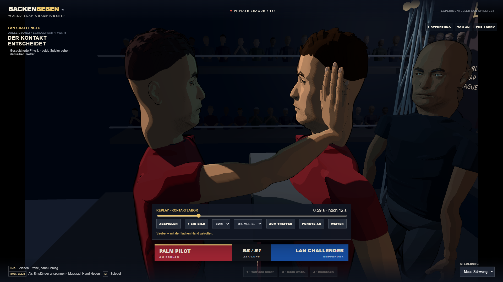

# BACKENBEBEN

Ein experimentelles 3D-Slap-Fighting-Spiel für private LAN-Duelle und Turniere im Browser.
Godot rendert die Arena; ein lokaler Python-Host verwaltet Regeln, Physik und Matches.
Der Look orientiert sich an kantiger Comicgrafik und dem ursprünglichen XIII.

## Aktueller Stand

Der aktuelle [Prototyp 14](https://github.com/r0bsta1909/backenbeben/releases/tag/v0.14.0-dev.20261011)
enthält anatomische Arm-/Handmodelle, körpergebundene seitliche Schläge und vom Host
aufgezeichnete Kontakt-/Gesichtsreplays. Weitere schadensfreie Probeschwünge sind
wählbar; Verletzungen und geschwollene Augen erscheinen auch im eigenen Spiegel.
Der Kontaktimpuls steuert die Wirkung; Kopfverschiebung und Drehung um drei Achsen
sind mit dem Gewebe gekoppelt. Eine konkretere Mausradhilfe begleitet die Proben; Gesichtstextur und
Schulterform sind überarbeitet. Die tatsächliche Probe lässt sich als Kontaktstandbild
betrachten; die Dreiviertelansicht zeigt den gesamten Schlagarm. Helfer setzen ihre
Füße, stützen den Kämpfer und folgen ihm mit dem Blick. Gesichtszeichnung und Hals
bleiben bei Kopfdrehungen verbunden. Modellierte Stofffalten ergänzen die Comicfiguren; das Publikum gehört zur gemalten Arena. Der aktuelle Stand
ergänzt Stofflinien, ruhigere Helferbeleuchtung und sichtbares Anspannen der Augenlider.
Tangentiale Reibung ist in den Hand-/Gewebekontakt integriert; die Berechnung wurde
beschleunigt, ohne Replayframes oder Solverprüfungen zu reduzieren.
Nach jeder Probe erscheint automatisch der seitliche Kontakt. Die Handneigung lässt
sich dort mit dem Mausrad vergleichen; „Zum Schlag bereitmachen“ führt zur
Egoansicht und Ausholhaltung zurück. Brauen, Bartzeichnung, Hautfarben und Beleuchtung
sind näher an den Konzeptbildern abgestimmt. Augen,
Brauen und Unterkiefer wurden überarbeitet; Startneigung ist −18°. Die Standardbalance
mit Grundschaden 35 ermöglicht K. o. durch mehrere starke Treffer.

Das Paket enthält die freigegebene Arena: gemalte Halle und
Publikum, ein 3D-Podest mit gepolstertem Tisch und verteilten Werbemotiven.
Spiel und Replay nutzen dieselbe Kulisse wie die Designvorschau. Treffer-Nahaufnahme, KO-Begleitkamera und kompakte Replay-Anzeigen sind enthalten.

Das [Kampfmodell](docs/COMBAT_MODEL.txt) trennt bleibende Gesichtsverletzungen,
Benommenheit und Gesamtbelastung. Gültige Schläge erhalten 0–10 Punkte; der erste
Treffer kann einen frischen Spieler nicht ausschalten. Benommenheit erholt sich
nach vollständigen Schlagpaaren. Ohne KO entscheiden die Punkte, Gleichstand ist Remis.

Der [Turniermodus](docs/TOURNAMENT.txt) unterstützt 2–20 Spieler mit zufälliger
Auslosung, automatischen Freilosen und genau einem Sieger. Über „Turnier erstellen“
einen Code teilen, beitreten lassen und starten. Weitere Runden entstehen automatisch.
Im Turnier gibt es bei Gleichstand bis zu drei zusätzliche Schlagpaare, danach einen
ausgewiesenen Losentscheid. Jeder neue Kampf beginnt unverletzt.
Die [interaktive UI-Vorschau](docs/ui-preview/tournament.html) zeigt Lobby,
Turnierbaum und Champion mit ausdrücklich fiktiven Beispieldaten; lokal im Browser öffnen.
Der Turniermodus gehört zum aktuellen Quellstand; das verlinkte V14-Releasepaket
ist älter. Im lokalen Projekt wurde der Webbuild neu erstellt.

Standardkampf, KO, Replay-Rücklauf, Wiedereinstieg und Revanche sind mit zwei
Browserclients geprüft. Das Hostpaket wurde außerhalb des Projekts mit frischer
Python-Umgebung getestet und der GitHub-Download per SHA256 abgeglichen.
Zwei Browserclients auf einem PC ersetzen keinen Test auf zwei physischen PCs.

**Experimenteller Stand, keine fertige Stil- oder Spielgefühlsabnahme.** Die letzte
menschliche Rückmeldung war „weiterhin unverständlich“; eine neue Abnahme steht aus.
Kopf/Kiefer, Wertung und KO verwenden teilweise vereinfachte Modelle. Der
[aktuelle Abnahmestand](docs/PROTOTYPE_STATUS.txt) und der
[verbindliche Gauntlet](docs/PROTOTYPE_GAUNTLET.txt) nennen die offenen Anforderungen.
Die [Konzeptbilder](docs/art-direction-v3/03-first-person.png) bleiben das Stilziel.

## Spielen unter Windows

1. Das Host-Paket aus den [Releases](https://github.com/r0bsta1909/backenbeben/releases) entpacken.
2. Python 3.12 installieren, falls noch nicht vorhanden.
3. `SETUP_HOST.bat` einmal ausführen: installiert nur die Host-Abhängigkeiten in `.venv`.
4. `LAN_SPIELEN.bat` auf beiden PCs starten: vorhandene Hosts werden automatisch gesucht.
   Auf dem ersten PC bei leerer Suche `H` wählen. Bei genau einem gefundenen Host
   öffnet sich das Spiel direkt; bei mehreren Hosts wählt ihr einen aus.
5. Im Spiel **LAN SPIELEN** öffnen: Spielerstatus und offene Turniere erscheinen
   automatisch. Turnieren direkt per Klick beitreten; für Duelle wählen beide
   **DUELL SUCHEN**. Pro Turnier sind 2 bis 20 Spieler möglich.
6. Alternativ `START_HOST.bat` starten und den angezeigten LAN-Link an Gäste geben.
   Über diesen Link brauchen Gäste nur ihren Browser, keine Python-Installation.

Das Paket enthält den fertigen Webbuild. Der normale Git-Checkout enthält die editierbaren
Quellen; vor dem Spielen daraus den Webbuild erstellen. Der Host bindet das lokale Netzwerk,
nicht für öffentliche Internetbereitstellung gedacht. Windows-Firewall ggf. für das private
Netzwerk freigeben; `ALLOW_LAN.bat` erlaubt dem tatsächlichen Spiel-Pythonprozess
TCP 8765 (Spiel) und UDP 8766 (Hostsuche), ausschließlich im lokalen Subnetz.
Standardmäßig gilt das nur für private Windows-Netzwerke. Wenn ein vertrauenswürdiges
LAN als öffentlich eingestuft ist, kann die Freigabe ausdrücklich mit
`powershell -File scripts/allow_lan.ps1 -IncludePublic` als Administrator ergänzt werden.
Die Netzwerkeinstufung selbst wird dabei nicht geändert.

Die automatische Suche benötigt die aktuelle Version auf beiden PCs und einen
vorbereiteten Python-Start über `SETUP_HOST.bat`. Sie funktioniert innerhalb des
Broadcast-Netzes; Gast-WLAN mit Geräteisolierung, getrennte VLANs und Router können
sie verhindern. Der direkte LAN-Link bleibt als Alternative verfügbar.
Die Verbindung wird regelmäßig geprüft. Bei ausbleibenden Antworten startet
innerhalb von etwa 12–15 Sekunden ein Wiederverbindungsversuch. Nach einem vom
Host erkannten Abbruch bleibt der Spielerplatz weiterhin 30 Sekunden reserviert.
Ein duplizierter Browser-Tab übernimmt die Sitzung; der alte Tab stoppt seine
Wiederverbindungsversuche. Die Hostsuche zeigt nur per HTTP geprüfte Spielserver.

Es ist keine Windows-Store-App erforderlich. Die neuen LAN-Funktionen sind im
aktuellen Quellstand und lokalen Build enthalten; ältere Releasepakete enthalten
sie noch nicht.

[Steuerung und Host-Befehle](SPIELEN.txt) · [Technische Tests](docs/GAUNTLET.txt)

## Entwickeln

- Godot 4.7.2 Compatibility Renderer + passende Web-Exportvorlagen.
- Blender 4.5.14 LTS für reproduzierbare Assets und editierbare `.blend`-Quellen.
- Python 3.12; Abhängigkeiten in `server/requirements.txt` und `tests/requirements.txt`.
- Lokale Portable-Tools sind absichtlich nicht in Git. Verzeichnislayout: [Toolchain](docs/TOOLCHAIN.txt).
- `BUILD_GAME.bat` exportiert `game/` nach `build/web/`.
- `scripts/create_character_v3.py` erzeugt die neue editierbare Blender-Figur und GLB.
- `python server/arm.py` erzeugt acht Prüfclips; `game/asset_lab.tscn` zeigt sie.
- `scripts/create_assets.py` erhält den historischen Prototyp-02-Assetstand.
- `python -m unittest discover -s tests -p "test_*.py"` prüft Regeln und Physik.
- Aktuelle Integrationstests: `tests/v3_browser_gauntlet.py` und `tests/v3_network_gauntlet.py`
  gegen einen separaten Host auf Port 8877. Playwright und Chrome werden dafür benötigt.

Der normale Hoststart im aktuellen Quellstand verwendet `coupled-friction`:
Kopfverschiebung, drei Rotationsachsen und tangentiale Hand-Gewebe-Reibung werden
gekoppelt berechnet. Der Reibungskoeffizient 0,2 und die Halsparameter sind
Prototypabstimmungen; die Kieferreaktion und der KO bleiben vereinfacht.
Kontakt, Auslauf und Arm-Rückholung verwenden dieselbe Aufzeichnung.

Ein separater Testhost lässt sich mit
`python server/host.py --port 8877 --no-browser --no-console` starten.
Nach einem Update einmal `SETUP_HOST.bat` ausführen. Die Rechenworker werden beim
Hoststart vorbereitet. Laufzeit und numerische Restfehler sind in den
[Vergleichsmessungen](docs/validation/friction-default.json) dokumentiert.

Für technische Vergleiche bleiben `--physics coupled-spatial` (ohne Reibung),
`--physics coupled-moving` (nur Yaw), `--physics coupled` (verankerter Kopf)
und `--physics legacy` verfügbar. Der öffentliche Download Prototyp 14 verwendet
standardmäßig den gekoppelten Kontakt mit Reibung.
Der gezielte Browsercheck
lautet `python tests/replay_contact_view.py --expect-moving --expect-spatial --inspect-timeout --visual-contact`.

Der vertiefte Kragen macht den Hals sichtbar. Im K.-o.-Replay folgen Front- und
Dreiviertelkamera dem absinkenden Kopf; die Totale bleibt fest. Der Build bricht
auch bei Godot-Skriptfehlern mit irreführendem Exitcode 0 ab.

## Wissenssicherung

Beginne bei [HANDOFF](docs/HANDOFF.txt): Produktziel, Nutzerfeedback, Architektur,
Entscheidungen, bekannte Grenzen, nächster konkreter Arbeitsschritt und GitHub-Workflow.
Weitere Referenzen: [Konzept](docs/KONZEPT.txt), [Backlog](docs/BACKLOG.txt),
[Art Direction und Prompts](docs/art-direction-v3/PROMPTS.txt), [Assetvertrag](docs/ASSETS.txt).

Fremde Referenzfotos/-screenshots, lokale Konfiguration, Zugangsdaten, Laufzeitdownloads
und rohe Matchlogs werden nicht veröffentlicht. Die neuen Konzeptbilder wurden mit
Imagegen erzeugt. Lizenzhinweise für den mitgelieferten Godot-Webruntime stehen unter
`third-party/`. Kopf, Arme und Hände verwenden in Blender angepasste CC0-Topologie von
MakeHuman; Quelldaten und Herkunft liegen unter `assets-source/makehuman/`. Für eigene Projektinhalte wurde bisher keine zusätzliche Lizenz gewählt.

Die Kontaktwertung verwendet inzwischen 116 aus der sichtbaren Hand exportierte
Oberflächenpunkte. [Geometrieprüfung, Integration und Grenzen](docs/HAND_CONTACT_SURFACE.txt).

Die aktuelle Quellversion koppelt die Wirkungsstaerke an den vom Kontaktsolver
berechneten Normalimpuls. Flaechenabdeckung und Foulregeln bleiben Teil der
Spielwertung. Die Umrechnung (2 N·s fuer volle Impulsstaerke) ist Spielbalance,
keine medizinische Verletzungsschwelle. Das v0.6-Paket enthält diese Integration einschließlich der vereinfachten
Kopfantwort aus dem Kontaktdrehimpuls.
